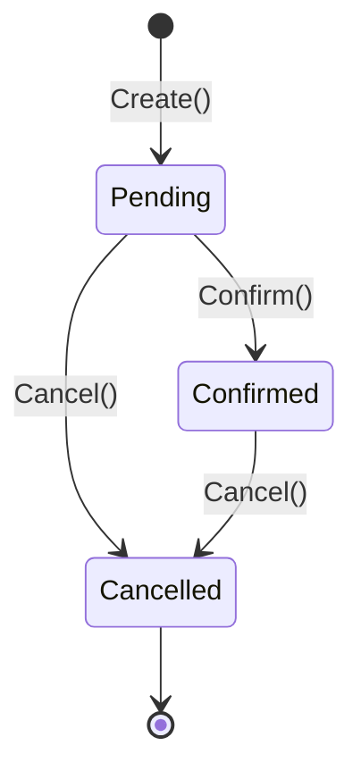
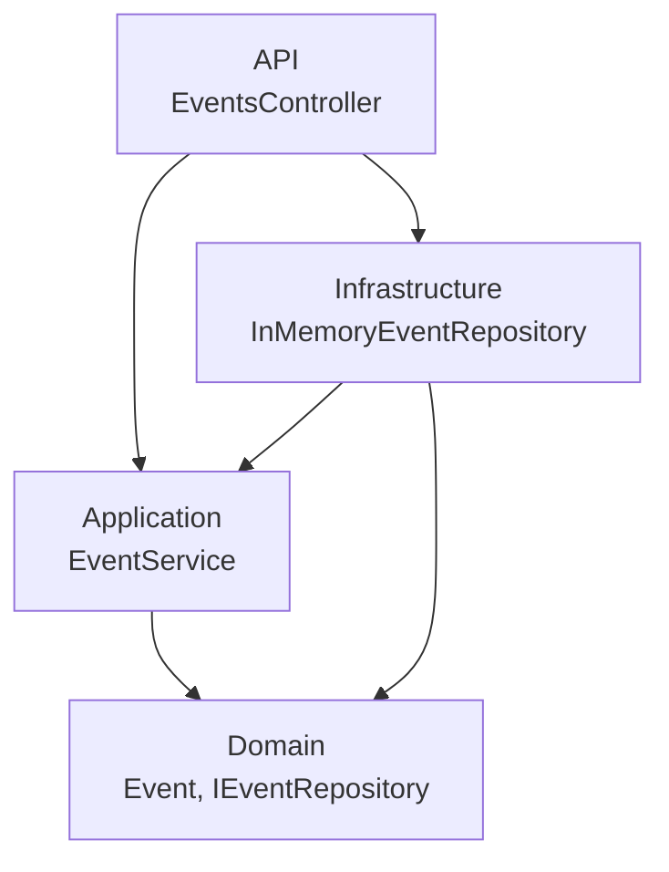

# EduHub

```powershell
dotnet restore
dotnet build
dotnet run --project src/EduHub.API
dotnet test
```

# TRA-LOI.md

## a) Bốn trụ cột của lập trình hướng đối tượng

### 1. Đóng gói (Encapsulation)
- **Giải thích:** Gom dữ liệu và phương thức xử lý vào cùng một lớp, ẩn trạng thái bên trong, chỉ cho thay đổi qua phương thức công khai.
- **Minh họa:** Tệp `EduHub.Domain/Entities/Club.cs`, lớp `Club`. Các thuộc tính (`Name`, `Description`, ...) có `private set`, hàm tạo là `private`, nên bên ngoài chỉ tạo được đối tượng qua `Club.Create(...)`, và hàm này kiểm tra tên không rỗng.

### 2. Kế thừa (Inheritance)
- **Giải thích:** Lớp con thừa hưởng thành viên của lớp cha, giúp tái sử dụng code.
- **Minh họa:** Tệp `EduHub.API/Controllers/ClubsController.cs`, lớp `ClubsController` kế thừa `ControllerBase` của ASP.NET Core, nên dùng được sẵn `Ok()`, `NotFound()`, `BadRequest()`, `CreatedAtAction()`, `NoContent()`.

### 3. Đa hình (Polymorphism)
- **Giải thích:** Cùng một giao diện nhưng nhiều lớp cài đặt khác nhau; nơi sử dụng chỉ làm việc với kiểu trừu tượng mà không cần biết lớp cụ thể.
- **Minh họa:** Tệp `EduHub.Infrastructure/Repositories/InMemoryClubRepository.cs`, lớp `InMemoryClubRepository` cài đặt `IClubRepository`. `CreateClubCommandHandler` (tệp `EduHub.Application/Clubs/CreateClubCommand.cs`) chỉ giữ tham chiếu kiểu `IClubRepository`, nên có thể thay bằng `EfClubRepository` ở chương sau hoặc dùng mock khi test mà không phải sửa handler.

### 4. Trừu tượng (Abstraction)
- **Giải thích:** Chỉ khai báo "làm gì", che giấu "làm như thế nào".
- **Minh họa:** Tệp `EduHub.Domain/Interfaces/IClubRepository.cs`, interface `IClubRepository` khai báo `GetAllAsync`, `GetByIdAsync`, `AddAsync`, `UpdateAsync`, `DeleteAsync` mà không nói dữ liệu lưu ở đâu (List, SQL, ...). Phần cài đặt nằm ở lớp `InMemoryClubRepository`.


## b) Hai vấn đề của lớp Member chưa đóng gói

1. **Setter công khai (`public set`)**: bên ngoài sửa trực tiếp `Id` và `Email` bằng cách gán tùy ý (ví dụ `m.Email = "abc"`), không qua kiểm tra nào, nên đối tượng có thể rơi vào trạng thái không hợp lệ.
2. **Hàm tạo công khai (`public Member() { }`)**: ai cũng `new Member()` được và tạo ra đối tượng rỗng (Email = null), nên không có điểm nào bắt buộc kiểm tra dữ liệu ngay khi khởi tạo.

## Cau 2
## a) Sơ đồ trạng thái của Registration



Từ `Cancelled` không có mũi tên đi ra, vì phiếu đã huỷ không đổi được nữa.

## Câu 3a) Các nguyên lý SOLID bị vi phạm

1. **SRP (Single Responsibility)**: dòng 6-14. Một phương thức làm 4 việc: kiểm tra dữ liệu (dòng 6-7), lưu SQL (dòng 8-9), ghi log ra file (dòng 10), gửi thông báo (dòng 11-14). Đổi cách lưu, ghi log hay gửi thông báo đều phải sửa `EventService`.
2. **OCP (Open/Closed)**: dòng 11-14. Chuỗi `if/else if` theo `channel`; thêm kênh mới (ví dụ "push") phải sửa code của `CreateEvent` thay vì chỉ thêm lớp mới.
3. **DIP (Dependency Inversion)**: dòng 8, 12, 14. Lớp nghiệp vụ tự `new SqlConnection`, `new EmailSender`, `new SmsSender`, tức phụ thuộc trực tiếp vào lớp cụ thể, nên không thay thế hay mock để test được.

## Câu 4b) git merge và git rebase

- **git merge**: gộp nhánh bằng một merge commit, giữ nguyên lịch sử gốc của cả hai nhánh (lịch sử có dạng rẽ nhánh, không thay đổi commit cũ).
- **git rebase**: "dời" các commit của nhánh hiện tại lên đầu nhánh đích bằng cách tạo lại các commit mới (SHA mới), cho lịch sử thẳng một đường, gọn hơn.

**Không nên dùng rebase** khi nhánh đã được push và người khác đang dùng chung (ví dụ `main`, nhánh dùng chung của nhóm), vì rebase viết lại lịch sử, buộc phải `push --force`, làm lịch sử của đồng đội bị lệch và dễ xung đột. Trường hợp này dùng merge. Rebase chỉ nên dùng trên nhánh cá nhân chưa chia sẻ.

## Câu 5a) Sơ đồ bốn lớp và chiều phụ thuộc



Mũi tên chỉ chiều phụ thuộc (A → B nghĩa là A tham chiếu B). Mọi mũi tên hướng vào trong về phía Domain. API tham chiếu Infrastructure chỉ để đăng ký DI trong `Program.cs`.

## Câu 5b) Vì sao Domain không được tham chiếu Infrastructure

Theo Dependency Rule, lớp trong (Domain chứa luật nghiệp vụ) không được biết gì về lớp ngoài (cơ sở dữ liệu, framework), nếu không đổi công nghệ lưu trữ sẽ kéo theo sửa Domain. Ngoài ra, Infrastructure đã phụ thuộc Domain nên Domain tham chiếu ngược lại sẽ tạo vòng tham chiếu và .NET không biên dịch được. Vì vậy Domain chỉ khai báo `IEventRepository`, còn Infrastructure cài đặt (Dependency Inversion).